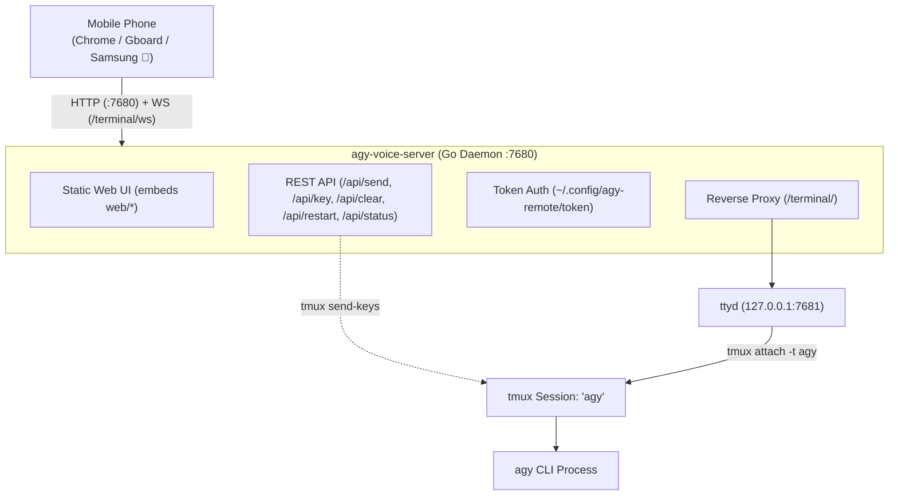

# agy Voice Remote

Mobile companion web app for controlling interactive [`agy`](https://github.com/) CLI sessions via phone dictation, live terminal streaming, and thumb touch controls over LAN/Tailscale.

---

## 1. Architecture



---

## 2. Mobile UI Layout

| Zone | Elements | Purpose |
| :--- | :--- | :--- |
| **Top Bar** | `📁 Folder`, `⟳ Reset`, `Interrupt`, `Send Now`, `/clear` | Folder selector (`~` & `~/Gits/*` auto-restarting `agy`), `tmux` session restart, `Esc` turn interrupt, instant submit / Enter, `/clear` conversation |
| **Terminal** | `<iframe>` `/terminal/` | Full-color live TUI; touch scroll via tmux mouse mode; auto-reconnecting watchdog |
| **Nav Bar** | `/`, `tab`, `esc`, `←`, `↑`, `↓`, `→`, `↵` | Slash commands picker, autocomplete, dismiss menus, list/history/slider navigation, and Return/Enter |

---

## 3. Operations & CLI

All services run as `systemd --user` units:

```bash
# Show QR code and connection URL for mobile browser
./agy-remote qr

# Attach directly to the shared tmux session on PC
./agy-remote attach

# Check status of all backend services
./agy-remote status

# Restart services after code changes
./agy-remote restart

# Generate a new access token
./agy-remote new-token
```

### Systemd Units

- `agy-tmux.service`: Detached `tmux` session hosting `agy`.
- `agy-ttyd.service`: Loopback terminal server (`127.0.0.1:7681`).
- `agy-voice-ui.service`: Compiled Go server (`0.0.0.0:7680`).

---

## 4. Build & Development

Static frontend files in [`web/`](web/) are embedded directly into the Go binary at compile time.

```bash
# Rebuild the standalone binary
/usr/local/go/bin/go build -o agy-voice-server main.go

# Restart the daemon
systemctl --user restart agy-voice-ui.service
```
